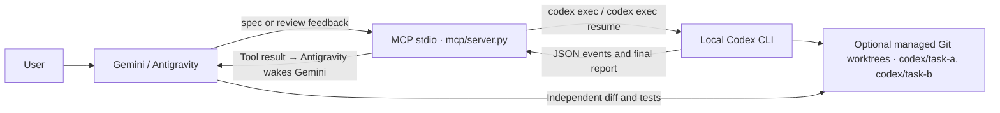

<div align="center">

**English** · [简体中文](README.zh-CN.md)

# Codex Castor

*Zero-dependency async MCP server, orchestrator skill, and workflow toolkit pairing Gemini (Antigravity) as Architect with local Codex CLI as Implementation Worker.*

[Project Homepage](https://jay201368.github.io/codex-castor/) · [Quickstart](#quickstart) · [6 MCP Tools](#mcp-tools) · [Orchestrator Skill](skills/codex-orchestrator/SKILL.md) · [MIT License](LICENSE)


</div>

## Why Codex Castor?

- **One architect, independent implementation.** Gemini clarifies requirements, reads the repository, writes the brief, and independently reviews code and runs checks. Codex implements the brief locally.
- **Zero polling.** Antigravity runs dispatch and resume with `background: "always"` and wakes Gemini when the tool returns. Gemini can end its turn and spend zero tokens waiting while Codex works.
- **Live observability at zero LLM tokens.** Codex session rollouts reveal the model and reasoning effort actually in use. The server records activity from `item.started` and `item.completed` in `meta.json` and sends opt-in MCP progress and log notifications. The Antigravity CLI status bar (`scripts/statusline.py`), terminal watcher (`scripts/watch.py`), and Antigravity App monitor (`codex_monitor`, `mcp/monitor.html`) show progress and flag settings that differ from `.codex/config.toml`.
- **Parallel Git worktrees.** Give each concurrent worker on the same repository a separate working tree and branch.
- **Structured handoff.** [The report schema](mcp/report.schema.json) defines six fields: `status`, `summary`, `files_changed`, `commands_run`, `tests_summary`, and `open_issues`.
- **Rework in context.** `codex_resume` sends review feedback to the same Codex session, preserving its memory and working directory.
- **Zero Python dependencies.** The MCP server uses only the Python 3.9+ standard library.

## Architecture & lifecycle



The server uses newline-delimited JSON-RPC 2.0 over stdio and handles each tool call in a worker thread. The Antigravity config sets `timeoutSeconds: -1`. The server streams Codex events to disk and returns a compact result containing `report`, `git.diff_stat`, `git.status_short`, and artifact paths. Antigravity handles the background call and wakeup.

## What's included

| Path | Purpose |
| --- | --- |
| [`mcp/server.py`](mcp/server.py) | Stdio MCP server that manages subprocesses and worktrees, tracks live model and effort from rollouts, sends MCP progress and log notifications, and serves the monitor as an MCP Apps resource. |
| [`mcp/report.schema.json`](mcp/report.schema.json) | JSON Schema passed to Codex for the final report. |
| [`mcp/monitor.html`](mcp/monitor.html) | Self-contained MCP App at `ui://codex-castor/monitor.html` for the Antigravity App side panel and full-page view. |
| [`skills/codex-orchestrator/SKILL.md`](skills/codex-orchestrator/SKILL.md) | Gemini's procedure for writing specs, delegating, and accepting or returning work. |
| [`config/mcp_config.example.json`](config/mcp_config.example.json) | Antigravity MCP wiring and per-tool background settings. |
| [`config/GEMINI.md`](config/GEMINI.md) | Global role division and delegation protocol. |
| [`scripts/install.py`](scripts/install.py) · [`scripts/install.sh`](scripts/install.sh) | Installer and its POSIX shell entry point. |
| [`scripts/doctor.py`](scripts/doctor.py) | Environment and installation diagnostics, including a live MCP stdio handshake. |
| [`scripts/statusline.py`](scripts/statusline.py) | Native Antigravity CLI `statusLine` renderer with `stack_with_default: true`. |
| [`scripts/watch.py`](scripts/watch.py) | Standalone live terminal dashboard and `--follow` event stream. |
| [`tests/`](tests/) | Automated checks run through Python's unittest discovery. |

<a name="quickstart"></a>

## Quickstart installation

You need **Python 3.9+**, **Git**, a working **Codex CLI** with its account configured, and **Antigravity**.

```sh
git clone https://github.com/JAY201368/codex-castor.git && cd codex-castor && ./scripts/install.sh
```

To add the Antigravity CLI status bar, run `./scripts/install.sh --install-statusline` or `python3 scripts/install.py --install-statusline` from the clone. Add `--force-statusline` only when replacing an existing custom status line.

Reload Antigravity so it picks up the MCP configuration and skill, then verify the installation from the clone:

```sh
python3 scripts/doctor.py
```

For local development, run `python3 scripts/install.py --symlink` to link installed files to the checkout. Use `--gemini-dir PATH` for a custom Gemini directory, `--python PATH` or `--codex-bin PATH` to select executables, `--skip-gemini-md` to skip the global instructions, and `--dry-run` to preview changes. Pass the same `--gemini-dir` to Doctor if you used a custom directory. Add `--json` for machine-readable diagnostics.

**Manual setup.** Merge the `codex-castor` entry from [the example config](config/mcp_config.example.json) into `~/.gemini/config/mcp_config.json`. Point `command` to Python 3.9+ and set the server argument to the absolute path of either the repository's `mcp/server.py` or an installed copy. Keep `report.schema.json` and `monitor.html` beside the server, and set `CODEX_BIN` to your executable. Install the [orchestrator skill](skills/codex-orchestrator/SKILL.md) at `~/.gemini/config/skills/codex-orchestrator/SKILL.md` and merge the [global protocol](config/GEMINI.md) into `~/.gemini/GEMINI.md`.

**Uninstall an installer-managed setup.** Run the following command. Add `--purge-state` only when you also intend to remove saved Castor state.

```sh
python3 scripts/install.py --uninstall
```

### Live monitoring

- **Terminal.** Run `python3 scripts/watch.py` for the live dashboard or `python3 scripts/watch.py --follow` to follow a task’s event stream. Pass a task ID after `--follow` to select it explicitly.
- **Antigravity CLI.** Install with `--install-statusline` to show active tasks below the built-in bar (`stack_with_default: true`). The Castor status line stays silent when idle.
- **Antigravity App.** Open **Codex Monitor** in the side panel or full-page view. The `codex_monitor` tool links to `ui://codex-castor/monitor.html`, advertised by `resources/list`. The panel refreshes via `tools/call` every 2 seconds while tasks are active and every 8 seconds when idle, at zero LLM tokens. Use **Cancel** and confirm to stop a running task.
- **MCP clients.** For live activity on dispatch or resume, pass `_meta.progressToken` to receive `notifications/progress`, or set the logging level to `info` or `debug` via `logging/setLevel` to receive `notifications/message`.

For each field, the server resolves the **effective model and reasoning effort** in this order: live Codex rollout `turn_context` → explicit `codex_dispatch` or `codex_resume` override → previous round → project `.codex/config.toml`, then user `~/.codex/config.toml` (or `$CODEX_HOME/config.toml`). The displays flag differences from the configured defaults.

<a name="mcp-tools"></a>

## MCP tools reference

All six tools use `eager: true` in the Antigravity configuration. Background mode is configured on the client.

| Tool | Background | Key inputs | When to use |
| --- | --- | --- | --- |
| `codex_dispatch` | `always` | Absolute `workdir`, `spec` or `spec_file`. Optional `task_id`, `use_worktree` (default `false`), `base_ref` (default `HEAD`), `model`, `reasoning_effort`, `extra_writable_dirs`. | Start a new implementation from a self-contained Markdown spec. |
| `codex_resume` | `always` | `task_id` or `session_id` plus `workdir`, and `feedback` or `feedback_file`. Optional `model`, `reasoning_effort`. | Send concrete review feedback to an existing session. |
| `codex_status` | `off` | `task_id` for one task or `limit` for recent tasks (default 20). | Take a one-off snapshot on explicit request or during post-mortem debugging. |
| `codex_cancel` | `off` | `task_id`. | Terminate the running Codex process group with `SIGTERM`, then `SIGKILL` if it persists. |
| `codex_cleanup_worktree` | `off` | `task_id`. Optional `delete_branch` and `force`, both defaulting to `false`. | Remove a managed worktree after review and merge, or after deciding to discard it. Force can discard local changes and delete an unmerged branch. |
| `codex_monitor` | `off` | Optional `task_id` to select a task and `limit` to cap the list (default 20). | Open Codex Monitor in the Antigravity App side panel or full-page view, or get a structured snapshot of running and recent tasks with effective model, reasoning effort, elapsed time, and recent activity. |

## Collaboration workflow & zero polling

1. **Write a self-contained spec.** Inspect the repository first. Cover objective, context and key files, detailed requirements, constraints and non-goals, verification commands, and acceptance criteria.
2. **Dispatch and yield.** Set `use_worktree: true` for two or more concurrent workers in one repository. Send the task ID and branch to the user, then end the turn or handle unrelated work. Wait for the background result without a status loop, sleep, or scheduled timer.
3. **Review independently.** On wakeup, read the returned report and Git summary, inspect the actual diff, and run the verification commands. Send file-specific feedback through `codex_resume` if rework is required. Otherwise merge or cherry-pick accepted changes before cleaning up the worktree.

See the [Orchestrator Skill](skills/codex-orchestrator/SKILL.md) for the complete procedure.

## Runtime state & artifacts

```text
~/.gemini/codex-castor/
├── tasks/
│   └── <task_id>/
│       ├── spec.md
│       ├── meta.json
│       ├── events-r1.jsonl
│       ├── stderr-r1.log
│       ├── report-r1.json
│       ├── feedback-r2.md
│       ├── events-r2.jsonl
│       ├── stderr-r2.log
│       └── report-r2.json
└── worktrees/
    └── <task_id>/           # managed checkout on codex/<task_id>
```

`CODEX_CASTOR_STATE_DIR` overrides the runtime root shown above. `CODEX_BIN` lets you specify the local Codex executable. A completed server run and the worker's report have separate status fields. Read both when deciding what to review or resume.

## Security & permissions

Both dispatch and resume pass `--dangerously-bypass-approvals-and-sandbox` and `--dangerously-bypass-hook-trust` to Codex for unattended execution. Use Codex Castor in trusted local developer workspaces. Managed Git worktrees separate checkouts and changes, while Codex retains the local user's permissions. Inspect the diff and run checks independently before merging.

## Testing & development

```sh
python3 -m unittest discover -s tests -v
python3 scripts/doctor.py --repo-only
```

---

[Illustrated Manuscript Homepage](https://jay201368.github.io/codex-castor/) · [MIT License](LICENSE)
