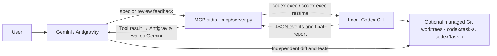

<div align="center">

**English** · [简体中文](README.zh-CN.md)

# Codex Castor

*Zero-dependency async MCP server, orchestrator skill, and workflow toolkit pairing Gemini (Antigravity) as Architect with local Codex CLI as Implementation Worker.*

[Project Homepage](https://jay201368.github.io/codex-castor/) · [Quickstart](#quickstart) · [7 MCP Tools](#mcp-tools) · [Orchestrator Skill](skills/codex-orchestrator/SKILL.md) · [MIT License](LICENSE)


</div>

## Why Codex Castor?

- **One architect, independent implementation.** Gemini clarifies requirements, reads the repository, writes the brief, and independently reviews code and runs checks. Codex implements the brief locally.
- **Zero polling.** Antigravity runs dispatch and resume with `background: "always"` and wakes Gemini when the tool returns. Gemini can end its turn and spend zero tokens waiting while Codex works.
- **Live observability at zero LLM tokens.** The CLI status bar (`scripts/statusline.py`) and terminal watcher (`scripts/watch.py`) show progress. Codex Monitor offers **Tasks** and **Analytics** views, shows effective model and reasoning effort in pills on task cards, and surfaces concise error summaries for failed tasks when available. The app refreshes every 1 second while active and every 8 seconds when idle.
- **Empirical model tuning & continuous UX improvement.** Castor pairs dispatch history with feedback from real tasks so you can learn which Codex models and reasoning levels fit the work and improve the workflow around users’ needs. It tracks per-round and cumulative duration and tokens, plus rework counts. The Antigravity hook captures first replies verbatim, and Codex Monitor saves 1–5 ratings, verdicts, tags, and notes through `codex_feedback`. Castor syncs `telemetry.jsonl`, `telemetry.csv`, and `report.md`. Monitor Analytics and `scripts/analytics.py` exclude failed tasks from aggregates.
- **Parallel Git worktrees.** Give each concurrent worker on the same repository a separate working tree and branch.
- **Structured handoff.** [The report schema](mcp/report.schema.json) defines six fields: `status`, `summary`, `files_changed`, `commands_run`, `tests_summary`, and `open_issues`.
- **Rework in context.** `codex_resume` sends review feedback to the same Codex session, preserving its memory and working directory.
- **Zero Python dependencies.** The MCP server uses only the Python 3.9+ standard library.

## Architecture & lifecycle



The server uses newline-delimited JSON-RPC 2.0 over stdio and handles each tool call in a worker thread. The Antigravity config sets `timeoutSeconds: -1`. The server streams Codex events to disk and returns a compact result containing `report`, `git.diff_stat`, `git.status_short`, round and cumulative telemetry, and artifact paths. Antigravity handles the background call and wakeup.

## What's included

| Path | Purpose |
| --- | --- |
| [`mcp/server.py`](mcp/server.py) | Stdio MCP server that manages subprocesses and worktrees, tracks live model and effort from rollouts, sends MCP progress and log notifications, summarizes failed runs, and serves Monitor snapshots, analytics, and session details. |
| [`mcp/report.schema.json`](mcp/report.schema.json) | JSON Schema passed to Codex for the final report. |
| [`mcp/telemetry.py`](mcp/telemetry.py) | Shared telemetry and feedback module with locked updates, synced exports, historical backfill, and analytics aggregation. |
| [`mcp/monitor.html`](mcp/monitor.html) | Self-contained MCP App at `ui://codex-castor/monitor.html` with Tasks and Analytics views, session detail sheets, and inline feedback. |
| [`skills/codex-orchestrator/SKILL.md`](skills/codex-orchestrator/SKILL.md) | Gemini's procedure for writing specs, selecting live models and effort, reviewing work, and reporting telemetry. |
| [`config/mcp_config.example.json`](config/mcp_config.example.json) | Antigravity MCP wiring and background settings for all seven tools. |
| [`config/GEMINI.md`](config/GEMINI.md) | Global role division and async delegation protocol, including the `[<model>·<effort>]` summary prefix. |
| [`scripts/install.py`](scripts/install.py) · [`scripts/install.sh`](scripts/install.sh) | Installs telemetry, analytics, and the hook beside the server and merges the hook registration into `hooks.json`. |
| [`scripts/doctor.py`](scripts/doctor.py) | Checks the environment, installed files, and hook registration, and runs an MCP stdio handshake. |
| [`scripts/hook.py`](scripts/hook.py) | Antigravity `PreInvocation` hook that captures first replies from the conversation transcript without using model tokens. |
| [`scripts/analytics.py`](scripts/analytics.py) | CLI for filtered summaries, historical backfill, feedback, and Markdown and CSV exports. |
| [`scripts/statusline.py`](scripts/statusline.py) | Native Antigravity CLI `statusLine` renderer with `stack_with_default: true`. |
| [`scripts/watch.py`](scripts/watch.py) | Standalone live terminal dashboard and `--follow` event stream. |
| [`tests/`](tests/) | Automated checks run through Python's unittest discovery. |

<a name="quickstart"></a>

## Quickstart installation

You need **Python 3.9+**, **Git**, a working **Codex CLI** with its account configured, and **Antigravity**.

```sh
git clone https://github.com/JAY201368/codex-castor.git && cd codex-castor && ./scripts/install.sh
```

To add the Antigravity CLI status bar, run `./scripts/install.sh --install-statusline` or `python3 scripts/install.py --install-statusline` from the clone. Add `--force-statusline` only when replacing an existing custom status line.

The installer registers the hook in `~/.gemini/config/hooks.json` and backs up the existing file to `hooks.json.bak` when it changes. Reload Antigravity to pick up the MCP configuration, hook, and skill, then verify the installation from the clone.

```sh
python3 scripts/doctor.py
```

For local development, run `python3 scripts/install.py --symlink` to link installed files to the checkout. Use `--gemini-dir PATH` for a custom Gemini directory, `--python PATH` or `--codex-bin PATH` to select executables, `--skip-gemini-md` to skip the global instructions, and `--dry-run` to preview changes. Pass the same `--gemini-dir` to Doctor if you used a custom directory. Add `--json` for machine-readable diagnostics.

**Manual setup.** Merge the `codex-castor` entry from [the example config](config/mcp_config.example.json) into `~/.gemini/config/mcp_config.json`. Point `command` to Python 3.9+ and set the server argument to the absolute path of either the repository's `mcp/server.py` or an installed copy. Keep `telemetry.py`, `report.schema.json`, and `monitor.html` beside `server.py`. For an installed copy, place `analytics.py` and executable `hook.py` there too. From the checkout, use `scripts/analytics.py` and `scripts/hook.py`. Set `CODEX_BIN` to your executable. Install the [orchestrator skill](skills/codex-orchestrator/SKILL.md) at `~/.gemini/config/skills/codex-orchestrator/SKILL.md` and merge the [global protocol](config/GEMINI.md) into `~/.gemini/GEMINI.md`.

Merge this entry into `~/.gemini/config/hooks.json` and substitute the absolute Python and hook paths.

```json
{
  "codex-castor": {
    "PreInvocation": [
      {
        "type": "command",
        "command": "[ ! -f '/path/to/hook.py' ] || '/path/to/python3' '/path/to/hook.py'",
        "timeout": 5
      }
    ]
  }
}
```

**Uninstall an installer-managed setup.** Run the following command. Add `--purge-state` only when you also intend to remove saved Castor state.

```sh
python3 scripts/install.py --uninstall
```

### Live monitoring & analytics

- **Terminal.** Run `python3 scripts/watch.py` for the live dashboard or `python3 scripts/watch.py --follow` to follow a task’s event stream. Pass a task ID after `--follow` to select it explicitly.
- **Antigravity CLI.** Install with `--install-statusline` to show active tasks below the built-in bar (`stack_with_default: true`). The Castor status line stays silent when idle.
- **Antigravity App.** Open **Codex Monitor** in the side panel or full-page view. The `codex_monitor` tool links to `ui://codex-castor/monitor.html`, advertised by `resources/list`. The app refreshes via `tools/call` every 1 second when any task is active or the selected task is live, and every 8 seconds when idle, at zero LLM tokens.
  - **Tasks** shows an active section and collapsible **By Project** groups for settled tasks, newest first by finish time. Cards show model and effort pills, recent activity, and concise failure reasons when available. Open a session for configuration, per-round runtime and usage, prompt history, the activity stream, and evaluation. The prompt and stream have expanded reading views. Rate, select a verdict, or leave a note inline. Use **Cancel** and confirm to stop a running task.
  - **Analytics** shows overall KPIs and a Model × Reasoning Effort performance matrix. Compare outcomes and ratings from past dispatches to choose model and effort settings for similar work. Both aggregates exclude failed tasks.
- **MCP clients.** Castor records activity from `item.started` and `item.completed` in `meta.json`. For live activity on dispatch or resume, pass `_meta.progressToken` to receive `notifications/progress`, or set the logging level to `info` or `debug` via `logging/setLevel` to receive `notifications/message`.

The server resolves each **effective model and reasoning effort** field from the current rollout’s `turn_context`, then an explicit `codex_dispatch` or `codex_resume` override, then the previous round, then project `.codex/config.toml` and user `~/.codex/config.toml` (or `$CODEX_HOME/config.toml`).

#### Telemetry & analytics CLI

Use the CLI to compare dispatch results and user ratings across models, reasoning levels, or projects before choosing settings for the next task. Run these commands from the repository. Every subcommand accepts `--state-dir PATH` to override the runtime directory.

```text
python3 scripts/analytics.py summary [--model MODEL] [--effort EFFORT] [--project PROJECT] [--since YYYY-MM-DD] [--limit N] [--json]
python3 scripts/analytics.py backfill [--json]
python3 scripts/analytics.py feedback TASK_ID [--rating 1-5] [--verdict VERDICT] [--tags TAG1,TAG2] [--notes TEXT] [--user-prompt TEXT] [--round N]
python3 scripts/analytics.py export [--md PATH] [--csv PATH]
```

- `summary` shows overall KPIs, the model and effort matrix, and recent tasks (15 by default). `--since` filters by task creation date, inclusive.
- `backfill` reconstructs the ledger and regenerates exports from saved task artifacts, preserving existing feedback.
- `feedback` updates the same records as `codex_feedback`, using the verdicts below and the current round by default.
- `export` regenerates Markdown and CSV reports. With no paths it writes both `report.md` and `telemetry.csv` in the state directory. With a path it writes the specified format.

<a name="mcp-tools"></a>

## MCP tools reference

All seven tools use `eager: true` in the Antigravity configuration. Background mode is configured on the client.

| Tool | Background | Key inputs | When to use |
| --- | --- | --- | --- |
| `codex_dispatch` | `always` | Absolute `workdir`, `spec` or `spec_file`. Optional `title` (short display title), `task_id`, `use_worktree` (default `false`), `base_ref` (default `HEAD`), `model`, `reasoning_effort`, `extra_writable_dirs`. | Start a new implementation from a self-contained Markdown spec. |
| `codex_resume` | `always` | `task_id` or `session_id` plus `workdir`, and `feedback` or `feedback_file`. Optional `model`, `reasoning_effort`. | Send concrete review feedback to an existing session. |
| `codex_feedback` | `off` | Required `task_id`. Optional `rating` (integer 1–5), `verdict` (`accepted`, `rework`, `partial`, `rejected`, `abandoned`), `tags` (string array), `notes`, `user_first_prompt`, and `round` (positive integer, defaults to current round). | Record or update task feedback or store the user's first reply verbatim for a finished round. Syncs `meta.json` and the telemetry exports. |
| `codex_status` | `off` | `task_id` for one task or `limit` for recent tasks (default 20). | Take a one-off snapshot on explicit request or during post-mortem debugging. |
| `codex_cancel` | `off` | `task_id`. | Terminate the running Codex process group with `SIGTERM`, then `SIGKILL` if it persists. |
| `codex_cleanup_worktree` | `off` | `task_id`. Optional `delete_branch` and `force`, both defaulting to `false`. | Remove a managed worktree after review and merge, or after deciding to discard it. Force can discard local changes and delete an unmerged branch. |
| `codex_monitor` | `off` | Optional `task_id`, `limit` (non-negative integer, default 20), and `include_detail` (boolean, default `false`). | Open the Tasks and Analytics views in Antigravity App, or get a structured snapshot with effective model and effort, elapsed time, activity, and analytics. With `task_id` and `include_detail: true`, returns `task_detail` with prompt history and activity within the response size budget. |

## Collaboration workflow & zero polling

1. **Write a self-contained spec.** Inspect the repository first. Cover objective, context and key files, detailed requirements, constraints and non-goals, verification commands, and acceptance criteria.
2. **Choose a model, dispatch, and yield.** Before the first dispatch of the session, read `~/.codex/models_cache.json` for available model slugs and supported reasoning levels. Fall back to `~/.codex/config.toml` if the cache is unavailable. Use the outcomes and user feedback collected in Step 4 to choose settings for similar tasks. Pass `model` and `reasoning_effort` explicitly on dispatch and prefix each dispatch or resume `toolSummary` with `[<model>·<effort>]`. Set `use_worktree: true` for two or more concurrent workers in one repository. Tell the user the task ID, model and effort, and branch when enabled, then end the turn or handle unrelated work. Wait for the background result without a status loop, sleep, or scheduled timer.
3. **Review independently.** On wakeup, read the returned report and Git summary, inspect the actual diff, and run the verification commands. Send file-specific feedback through `codex_resume` if rework is required. Otherwise merge or cherry-pick accepted changes before cleaning up the worktree.
4. **Report telemetry.** Include model·effort, rounds and reworks, total duration, and total tokens in the acceptance summary. The Antigravity `PreInvocation` hook automatically records the first user reply verbatim after a round finishes. Users can rate or leave notes in Codex Monitor. The accumulated record guides future routing in Step 2 and helps improve the workflow where users encounter friction.

See the [Orchestrator Skill](skills/codex-orchestrator/SKILL.md) for the complete procedure.

## Runtime state & artifacts

```text
~/.gemini/codex-castor/
├── telemetry.jsonl
├── telemetry.csv
├── report.md
├── hook_state/
│   └── <conversation_id>.json  # transcript cursor and pending rounds
├── tasks/
│   └── <task_id>/
│       ├── spec.md
│       ├── meta.json
│       ├── events-r1.jsonl
│       ├── stderr-r1.log
│       ├── report-r1.json
│       ├── feedback-r2.md
│       ├── events-r2.jsonl
│       ├── stderr-r2.log
│       └── report-r2.json
└── worktrees/
    └── <task_id>/           # managed checkout on codex/<task_id>
```

The JSONL task ledger, CSV export, and Markdown report are synced after rounds finish or feedback is saved. The local record pairs actual outcomes with user feedback to guide model and reasoning settings and improve day-to-day collaboration. Failed tasks remain in the records and recent-task logs. Analytics aggregates exclude them.

`CODEX_CASTOR_STATE_DIR` overrides the runtime root shown above. `CODEX_BIN` lets you specify the local Codex executable. A completed server run and the worker's report have separate status fields. Read both when deciding what to review or resume.

## Security & permissions

Both dispatch and resume pass `--dangerously-bypass-approvals-and-sandbox` and `--dangerously-bypass-hook-trust` to Codex for unattended execution. Use Codex Castor in trusted local developer workspaces. Managed Git worktrees separate checkouts and changes, while Codex retains the local user's permissions. Inspect the diff and run checks independently before merging.

## Testing & development

```sh
python3 -m unittest discover -s tests -v
python3 scripts/doctor.py --repo-only
```

---

[Illustrated Manuscript Homepage](https://jay201368.github.io/codex-castor/) · [MIT License](LICENSE)
