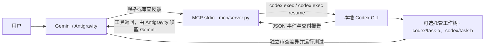

<div align="center">

[English](README.md) · **简体中文**

# Codex Castor

*面向 Gemini（Antigravity）与本地 Codex CLI 的零依赖异步 MCP 服务端，配套编排技能和工作流工具。Gemini 担任架构师，Codex 负责实现。*

[项目主页](https://jay201368.github.io/codex-castor/index.zh-CN.html) · [快速安装](#quickstart) · [七项 MCP 工具](#mcp-tools) · [编排技能](skills/codex-orchestrator/SKILL.md) · [MIT 许可证](LICENSE)


</div>

## 为什么使用 Codex Castor？

- **架构与实现分工。** Gemini 澄清需求、阅读仓库、撰写规格，并独立审查改动和运行检查。Codex 在本地按规格实现。
- **零轮询。** Antigravity 以 `background: "always"` 运行派发和续接工具，在工具返回时唤醒 Gemini。等待期间，Gemini 可以结束当前轮次，空闲时消耗零 token。
- **实时看进度，零模型 token。** CLI 状态栏（`scripts/statusline.py`）和终端看板（`scripts/watch.py`）显示任务进度。Codex Monitor 提供 **Tasks（任务）** 和 **Analytics（分析）** 视图，在任务卡片上以标签显示实际使用的模型和推理强度，并在可用时显示失败原因摘要。运行时每 1 秒刷新，空闲时每 8 秒刷新。
- **在实践中沉淀模型配置经验，持续改善使用体验。** Castor 将历史派发数据与实际任务中的用户反馈一并保存，帮助你了解哪些 Codex 模型和推理等级适合当前工作，并根据用户需求改进协作流程。它记录每轮及累计用时、token 用量和返工次数。`codex_feedback` 保存首条回复原文、1 至 5 分评分、评审结论、标签和备注。Castor 同步 `telemetry.jsonl`、`telemetry.csv` 和 `report.md`。看板的 Analytics 视图与 `scripts/analytics.py` 均将失败任务排除在汇总统计之外。
- **并行工作树。** 同一个仓库有多个并发执行者时，为每项任务分配独立的 Git 工作树和分支。
- **结构化交接。** [交付报告的 JSON Schema](mcp/report.schema.json) 定义六个字段：`status`、`summary`、`files_changed`、`commands_run`、`tests_summary` 和 `open_issues`。
- **带着上下文返工。** `codex_resume` 将审查意见交回原 Codex 会话，保留会话记忆和工作目录。
- **零 Python 依赖。** MCP 服务端只用 Python 3.9+ 标准库。

## 架构与执行流程



服务端通过 stdio 交换逐行分隔的 JSON-RPC 2.0 消息，每个工具调用由单独的线程处理。Antigravity 配置使用 `timeoutSeconds: -1`。服务端将 Codex 事件流写入磁盘，返回包含 `report`、`git.diff_stat`、`git.status_short`、本轮及累计运行指标和产物路径的精简结果。后台调度和完成唤醒由 Antigravity 负责。

## 仓库组件

| 路径 | 用途 |
| --- | --- |
| [`mcp/server.py`](mcp/server.py) | stdio MCP 服务端，管理子进程和工作树，从 rollout 日志跟踪模型与推理强度，发送 MCP 进度与日志通知，提取失败原因摘要，并提供看板快照、分析结果和会话详情。 |
| [`mcp/report.schema.json`](mcp/report.schema.json) | 传给 Codex 的交付报告 JSON Schema。 |
| [`mcp/telemetry.py`](mcp/telemetry.py) | 共用的运行指标与反馈模块，提供加锁更新、同步导出、历史回填和汇总统计。 |
| [`mcp/monitor.html`](mcp/monitor.html) | 独立的 MCP App，资源地址为 `ui://codex-castor/monitor.html`，包含任务与分析视图、会话详情页及内嵌反馈表单。 |
| [`skills/codex-orchestrator/SKILL.md`](skills/codex-orchestrator/SKILL.md) | Gemini 撰写规格、从当前可用模型中选择模型与推理强度、审查改动、汇报运行指标和记录用户首条回复的流程。 |
| [`config/mcp_config.example.json`](config/mcp_config.example.json) | Antigravity 的 MCP 接入示例及七项工具的后台运行设置。 |
| [`config/GEMINI.md`](config/GEMINI.md) | 全局角色分工与任务委派协议，包含摘要前缀 `[<model>·<effort>]` 和自动调用 `codex_feedback` 的规则。 |
| [`scripts/install.py`](scripts/install.py) · [`scripts/install.sh`](scripts/install.sh) | 安装器及 POSIX shell 入口，将运行指标模块和分析命令行工具一并装到服务端所在目录。 |
| [`scripts/doctor.py`](scripts/doctor.py) | 检查环境及安装文件，包括运行指标模块和分析工具，并实测 MCP stdio 握手。 |
| [`scripts/analytics.py`](scripts/analytics.py) | 用于筛选统计摘要、回填历史、记录反馈和导出 Markdown 与 CSV 的命令行工具。 |
| [`scripts/statusline.py`](scripts/statusline.py) | Antigravity CLI 原生 `statusLine` 脚本，借助 `stack_with_default: true` 与内置状态栏一同显示。 |
| [`scripts/watch.py`](scripts/watch.py) | 独立的终端实时看板，可用 `--follow` 跟踪事件流。 |
| [`tests/`](tests/) | 由 Python unittest 发现并运行的自动化测试。 |

<a name="quickstart"></a>

## 快速安装

运行前需准备好 **Python 3.9+**、**Git**、已登录的本地 **Codex CLI** 与 **Antigravity**。

```sh
git clone https://github.com/JAY201368/codex-castor.git && cd codex-castor && ./scripts/install.sh
```

如需启用 Antigravity CLI 状态栏，在仓库目录运行 `./scripts/install.sh --install-statusline` 或 `python3 scripts/install.py --install-statusline`。需要替换已有的自定义状态栏时，才加上 `--force-statusline`。

重新加载 Antigravity，使 MCP 配置和技能生效。然后在仓库目录下检查安装：

```sh
python3 scripts/doctor.py
```

开发时可用 `python3 scripts/install.py --symlink`，让安装文件链接到本地仓库。用 `--gemini-dir PATH` 指定 Gemini 目录，`--python PATH` 或 `--codex-bin PATH` 指定可执行文件，`--skip-gemini-md` 跳过全局说明文件，`--dry-run` 预览改动。自定义了 Gemini 目录时，给 Doctor 传入相同的 `--gemini-dir`。用 `--json` 获取机器可读的诊断结果。

**手动接入。** 将[示例配置](config/mcp_config.example.json)中的 `codex-castor` 条目合并到 `~/.gemini/config/mcp_config.json`。将 `command` 指向 Python 3.9+，把服务端参数设为仓库内 `mcp/server.py` 或其安装副本的绝对路径。`telemetry.py`、`report.schema.json` 和 `monitor.html` 应与 `server.py` 同目录。使用安装副本时，把 `analytics.py` 也放在该目录。从仓库运行时，使用 `scripts/analytics.py`。设置 `CODEX_BIN` 指向 Codex 可执行文件。将[编排技能](skills/codex-orchestrator/SKILL.md)装入 `~/.gemini/config/skills/codex-orchestrator/SKILL.md`，把[全局协议](config/GEMINI.md)合并到 `~/.gemini/GEMINI.md`。

**卸载由安装器管理的配置。** 执行以下命令。如需同时删除保存的 Castor 状态，再加上 `--purge-state`。

```sh
python3 scripts/install.py --uninstall
```

### 实时监控与分析

- **终端。** 运行 `python3 scripts/watch.py` 打开实时看板，或用 `python3 scripts/watch.py --follow` 跟踪任务事件流。也可在 `--follow` 后加任务 ID，直接跟踪指定任务。
- **Antigravity CLI。** 安装时加 `--install-statusline`，运行中的任务会显示在内置状态栏下方（`stack_with_default: true`）。空闲时不显示任务行。
- **Antigravity App。** 在侧栏或整页打开 **Codex Monitor**。`codex_monitor` 关联的 `ui://codex-castor/monitor.html` 可通过 `resources/list` 发现。有任务运行或当前选中的任务仍在运行时，看板经 `tools/call` 每 1 秒刷新一次，空闲时每 8 秒一次，不消耗模型 token。
  - **Tasks（任务）** 包含运行中区域，已结束的任务在可折叠的 **By Project（按项目）** 分组中按结束时间从近到远排列。任务卡片展示模型与推理强度标签、近期活动，以及可用的失败原因摘要。打开会话可查看配置、各轮用时与用量、提示词历史、活动流和评估。提示词和活动流可展开阅读。可直接评分、选择评审结论或填写备注。点击 **Cancel（取消）** 并确认即可停止运行中的任务。
  - **Analytics（分析）** 展示总体关键指标与模型 × 推理强度表现矩阵。比较历史派发的结果与评分，为同类工作选择模型和推理强度。两种统计均排除失败任务。
- **MCP 客户端。** Castor 把 `item.started` 和 `item.completed` 中的活动写入 `meta.json`。派发或续接时传入 `_meta.progressToken`，即可收到 `notifications/progress`。也可用 `logging/setLevel` 将日志级别设为 `info` 或 `debug`，接收 `notifications/message`。

服务端逐项确定**实际使用的模型和推理强度**，依次查找当前轮 rollout 中的 `turn_context`、`codex_dispatch` 或 `codex_resume` 显式传入的值、上一轮的值、项目的 `.codex/config.toml` 和用户的 `~/.codex/config.toml`（或 `$CODEX_HOME/config.toml`）。

#### 运行指标与分析命令行工具

用命令行工具按模型、推理等级或项目比较派发结果与用户评分，为下一次任务选择配置。在仓库目录运行下列命令。每个子命令都接受 `--state-dir PATH`，用于指定运行状态目录。

```text
python3 scripts/analytics.py summary [--model MODEL] [--effort EFFORT] [--project PROJECT] [--since YYYY-MM-DD] [--limit N] [--json]
python3 scripts/analytics.py backfill [--json]
python3 scripts/analytics.py feedback TASK_ID [--rating 1-5] [--verdict VERDICT] [--tags TAG1,TAG2] [--notes TEXT] [--user-prompt TEXT] [--round N]
python3 scripts/analytics.py export [--md PATH] [--csv PATH]
```

- `summary` 显示总体关键指标、模型与推理强度表现矩阵，以及近期任务（默认 15 项）。`--since` 按任务创建日期筛选，包含指定当天。
- `backfill` 从已保存的任务产物重建账本并重新生成导出文件，同时保留已有反馈。
- `feedback` 与 `codex_feedback` 更新同一份记录，评审结论使用下表所列的值，轮次默认为当前轮。
- `export` 重新生成 Markdown 和 CSV 报告。省略路径时，在状态目录生成 `report.md` 和 `telemetry.csv`。提供路径时生成指定格式的文件。

<a name="mcp-tools"></a>

## MCP 工具参考

七项工具在 Antigravity 配置中均为 `eager: true`。后台运行方式由客户端配置决定。

| 工具 | 后台模式 | 关键参数 | 使用时机 |
| --- | --- | --- | --- |
| `codex_dispatch` | `always` | 绝对路径 `workdir`，以及 `spec` 或 `spec_file`。可选 `title`（简短的显示标题）、`task_id`、`use_worktree`（默认 `false`）、`base_ref`（默认 `HEAD`）、`model`、`reasoning_effort`、`extra_writable_dirs`。 | 根据自洽完整的 Markdown 规格启动新任务。 |
| `codex_resume` | `always` | `task_id`，或同时提供 `session_id` 与 `workdir`。还需提供 `feedback` 或 `feedback_file`。可选 `model`、`reasoning_effort`。 | 将具体审查意见交回已有的 Codex 会话。 |
| `codex_feedback` | `off` | 必填 `task_id`。可选 `rating`（1 至 5 的整数）、`verdict`（`accepted`、`rework`、`partial`、`rejected`、`abandoned`）、`tags`（字符串数组）、`notes`、`user_first_prompt` 和 `round`（正整数，默认为当前轮）。 | 记录或更新任务反馈，或逐字保存一轮结束后用户的首条回复，同步 `meta.json` 和运行指标导出文件。 |
| `codex_status` | `off` | 用 `task_id` 查看单项任务，或用 `limit` 列出近期任务（默认 20 项）。 | 用户明确询问进度或事后排查时，查询一次状态。 |
| `codex_cancel` | `off` | `task_id`。 | 向运行中的 Codex 进程组发送 `SIGTERM`，若进程仍未退出，再发送 `SIGKILL`。 |
| `codex_cleanup_worktree` | `off` | `task_id`。可选 `delete_branch`、`force`，默认均为 `false`。 | 审查并合并改动后，或决定放弃改动后，移除任务对应的托管 Git worktree；开启 force 可能丢弃未提交改动并强删未合并分支。 |
| `codex_monitor` | `off` | 可选 `task_id`、`limit`（非负整数，默认 20）和 `include_detail`（布尔值，默认 `false`）。 | 在 Antigravity App 打开任务与分析视图，或读取结构化快照，查看实际使用的模型、推理强度、已用时间、活动和分析数据。提供 `task_id` 和 `include_detail: true` 时返回 `task_detail`，在响应大小限制内包含提示词历史与活动流。 |

## 协作流程与零轮询

1. **撰写可独立执行的规格。** 先阅读仓库，再写明任务目标、上下文与关键文件、详细要求、约束与非目标、验证命令、验收标准。
2. **选择模型、异步派发，再让出当前轮次。** 会话首次派发前，从 `~/.codex/models_cache.json` 读取当前可用的模型标识和受支持的推理等级。缓存不可用时，查阅 `~/.codex/config.toml`。为同类任务选择配置时，参考第 4 步积累的任务结果与用户反馈。派发时显式传入 `model` 和 `reasoning_effort`，每次派发或续接的 `toolSummary` 均以 `[<model>·<effort>]` 开头。同一仓库有两个或更多并发执行者时，设置 `use_worktree: true`。向用户说明任务 ID、模型、推理强度以及启用工作树时的分支，随后结束本轮或处理无关事项。等待后台结果即可，省去状态循环、休眠和定时查询。
3. **独立验收。** 收到完成通知后阅读报告与 Git 摘要，查看实际差异并运行验证命令。需要修订时用 `codex_resume` 发送定位到文件的反馈。通过后先合并或拣选改动，再清理托管工作树。
4. **汇报运行指标并记录首条回复。** 在验收摘要中列出模型与推理强度、总轮次与返工次数、累计耗时及 token 总量。汇报任一轮结果后，在处理用户的首条回复前，先按对应的 `task_id` 和 `round` 调用 `codex_feedback` 逐字保存，并记录用户表达的评分、评审结论、标签或备注。用户也可直接在 Codex Monitor 评分或填写备注。积累下来的记录为后续第 2 步的模型和推理强度选择提供依据，也帮助解决用户在协作中遇到的问题。

完整流程见[编排技能](skills/codex-orchestrator/SKILL.md)。

## 运行状态与产物

```text
~/.gemini/codex-castor/
├── telemetry.jsonl
├── telemetry.csv
├── report.md
├── tasks/
│   └── <task_id>/
│       ├── spec.md
│       ├── meta.json
│       ├── events-r1.jsonl
│       ├── stderr-r1.log
│       ├── report-r1.json
│       ├── feedback-r2.md
│       ├── events-r2.jsonl
│       ├── stderr-r2.log
│       └── report-r2.json
└── worktrees/
    └── <task_id>/           # 托管工作树，分支为 codex/<task_id>
```

每轮结束或保存反馈时，会同步 JSONL 任务账本、CSV 导出文件和 Markdown 报告。本地记录将实际任务结果与用户反馈一并保存，为调整模型和推理强度、改善日常协作提供依据。失败任务保留在记录和近期任务日志中，汇总统计会排除这些任务。

用 `CODEX_CASTOR_STATE_DIR` 覆盖上面的运行状态根目录，用 `CODEX_BIN` 指定本地 Codex 可执行文件。外层进程状态与 report 中的任务状态是两个独立字段，验收或返工前应一并检查。

## 安全与权限

为了支持无人值守的自主实现，派发和续接都会向 Codex 传入 `--dangerously-bypass-approvals-and-sandbox` 与 `--dangerously-bypass-hook-trust`，请仅在可信的本地开发工作区中使用。Git worktree 可以隔离文件改动与分支，但 Codex 仍以当前系统用户权限运行；合并前请独立审查 `git diff` 并运行测试。

## 测试与开发

```sh
python3 -m unittest discover -s tests -v
python3 scripts/doctor.py --repo-only
```

---

[手稿插图主页](https://jay201368.github.io/codex-castor/index.zh-CN.html) · [MIT 许可证](LICENSE)
