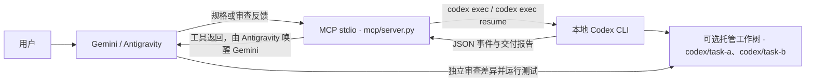

<div align="center">

[English](README.md) · **简体中文**

# Codex Castor

*面向 Gemini（Antigravity）与本地 Codex CLI 的零依赖异步 MCP 服务端，配套编排技能和工作流工具。Gemini 担任架构师，Codex 负责实现。*

[项目主页](https://jay201368.github.io/codex-castor/index.zh-CN.html) · [快速安装](#quickstart) · [六项 MCP 工具](#mcp-tools) · [编排技能](skills/codex-orchestrator/SKILL.md) · [MIT 许可证](LICENSE)


</div>

## 为什么使用 Codex Castor？

- **架构与实现分工。** Gemini 澄清需求、阅读仓库、撰写规格，并独立审查改动和运行检查。Codex 在本地按规格实现。
- **零轮询。** Antigravity 以 `background: "always"` 运行派发和续接工具，在工具返回时唤醒 Gemini。等待期间，Gemini 可以结束当前轮次，空闲时消耗零 token。
- **实时看进度，零模型 token。** 服务端从 Codex 会话的 rollout 日志读取实际使用的模型和推理强度，把 `item.started` 和 `item.completed` 中的活动写入 `meta.json`，并按客户端设置发送 MCP 进度与日志通知。Antigravity CLI 状态栏（`scripts/statusline.py`）、终端看板（`scripts/watch.py`）和 Antigravity App 的 Codex Monitor（`codex_monitor`、`mcp/monitor.html`）都会显示进度，并标出与 `.codex/config.toml` 不同的设置。
- **并行工作树。** 同一个仓库有多个并发执行者时，为每项任务分配独立的 Git 工作树和分支。
- **结构化交接。** [交付报告的 JSON Schema](mcp/report.schema.json) 定义六个字段：`status`、`summary`、`files_changed`、`commands_run`、`tests_summary` 和 `open_issues`。
- **带着上下文返工。** `codex_resume` 将审查意见交回原 Codex 会话，保留会话记忆和工作目录。
- **零 Python 依赖。** MCP 服务端只用 Python 3.9+ 标准库。

## 架构与执行流程



服务端通过 stdio 交换逐行分隔的 JSON-RPC 2.0 消息，每个工具调用由单独的线程处理。Antigravity 配置使用 `timeoutSeconds: -1`。服务端将 Codex 事件流写入磁盘，返回包含 `report`、`git.diff_stat`、`git.status_short` 和产物路径的精简结果。后台调度和完成唤醒由 Antigravity 负责。

## 仓库组件

| 路径 | 用途 |
| --- | --- |
| [`mcp/server.py`](mcp/server.py) | stdio MCP 服务端，管理子进程和工作树，从 rollout 日志实时跟踪模型与推理强度，发送 MCP 进度与日志通知，并提供 MCP Apps 资源。 |
| [`mcp/report.schema.json`](mcp/report.schema.json) | 传给 Codex 的交付报告 JSON Schema。 |
| [`mcp/monitor.html`](mcp/monitor.html) | 独立的 MCP App，资源地址为 `ui://codex-castor/monitor.html`，可在 Antigravity App 侧栏或整页打开。 |
| [`skills/codex-orchestrator/SKILL.md`](skills/codex-orchestrator/SKILL.md) | Gemini 撰写规格、派发任务、验收或发回返工的操作流程。 |
| [`config/mcp_config.example.json`](config/mcp_config.example.json) | Antigravity 的 MCP 接入示例及各工具后台运行设置。 |
| [`config/GEMINI.md`](config/GEMINI.md) | 全局角色分工与任务委派协议。 |
| [`scripts/install.py`](scripts/install.py) · [`scripts/install.sh`](scripts/install.sh) | 安装器及其 POSIX shell 入口。 |
| [`scripts/doctor.py`](scripts/doctor.py) | 检查环境与安装状态，并实际执行一次 MCP stdio 握手。 |
| [`scripts/statusline.py`](scripts/statusline.py) | Antigravity CLI 原生 `statusLine` 脚本，借助 `stack_with_default: true` 与内置状态栏一同显示。 |
| [`scripts/watch.py`](scripts/watch.py) | 独立的终端实时看板，可用 `--follow` 跟踪事件流。 |
| [`tests/`](tests/) | 由 Python unittest 发现并运行的自动化测试。 |

<a name="quickstart"></a>

## 快速安装

运行前需准备好 **Python 3.9+**、**Git**、已登录的本地 **Codex CLI** 与 **Antigravity**。

```sh
git clone https://github.com/JAY201368/codex-castor.git && cd codex-castor && ./scripts/install.sh
```

如需启用 Antigravity CLI 状态栏，在仓库目录运行 `./scripts/install.sh --install-statusline` 或 `python3 scripts/install.py --install-statusline`。需要替换已有的自定义状态栏时，才加上 `--force-statusline`。

重新加载 Antigravity，使 MCP 配置和技能生效。然后在仓库目录下检查安装：

```sh
python3 scripts/doctor.py
```

开发时可用 `python3 scripts/install.py --symlink`，让安装文件链接到本地仓库。用 `--gemini-dir PATH` 指定 Gemini 目录，`--python PATH` 或 `--codex-bin PATH` 指定可执行文件，`--skip-gemini-md` 跳过全局说明文件，`--dry-run` 预览改动。自定义了 Gemini 目录时，给 Doctor 传入相同的 `--gemini-dir`。用 `--json` 获取机器可读的诊断结果。

**手动接入。** 将[示例配置](config/mcp_config.example.json)中的 `codex-castor` 条目合并到 `~/.gemini/config/mcp_config.json`。将 `command` 指向 Python 3.9+，把服务端参数设为仓库内 `mcp/server.py` 或其安装副本的绝对路径，并将 `report.schema.json` 和 `monitor.html` 放在服务端文件旁。设置 `CODEX_BIN` 指向 Codex 可执行文件。将[编排技能](skills/codex-orchestrator/SKILL.md)装入 `~/.gemini/config/skills/codex-orchestrator/SKILL.md`，把[全局协议](config/GEMINI.md)合并到 `~/.gemini/GEMINI.md`。

**卸载由安装器管理的配置。** 执行以下命令。如需同时删除保存的 Castor 状态，再加上 `--purge-state`。

```sh
python3 scripts/install.py --uninstall
```

### 实时监控

- **终端。** 运行 `python3 scripts/watch.py` 打开实时看板，或用 `python3 scripts/watch.py --follow` 跟踪任务事件流。也可在 `--follow` 后加任务 ID，直接跟踪指定任务。
- **Antigravity CLI。** 安装时加 `--install-statusline`，运行中的任务会显示在内置状态栏下方（`stack_with_default: true`）。空闲时不显示任务行。
- **Antigravity App。** 在侧栏或整页打开 **Codex Monitor**。`codex_monitor` 关联的 `ui://codex-castor/monitor.html` 可通过 `resources/list` 发现。看板经 `tools/call` 刷新，有任务运行时每 2 秒一次，空闲时每 8 秒一次，不消耗模型 token。要停止任务，点击取消并确认。
- **MCP 客户端。** 派发或续接时传入 `_meta.progressToken`，即可收到 `notifications/progress`。也可用 `logging/setLevel` 将日志级别设为 `info` 或 `debug`，接收 `notifications/message`。

**实际使用的模型和推理强度**逐项按优先级取值：当前轮 Codex rollout 中的 `turn_context` → `codex_dispatch` 或 `codex_resume` 显式传入的值 → 上一轮的值 → 项目 `.codex/config.toml`，缺项再查用户的 `~/.codex/config.toml`（或 `$CODEX_HOME/config.toml`）。界面会标出与配置默认值不同的设置。

<a name="mcp-tools"></a>

## MCP 工具参考

六项工具在 Antigravity 配置中均为 `eager: true`。后台运行方式由客户端配置决定。

| 工具 | 后台模式 | 关键参数 | 使用时机 |
| --- | --- | --- | --- |
| `codex_dispatch` | `always` | 绝对路径 `workdir`，以及 `spec` 或 `spec_file`。可选 `task_id`、`use_worktree`（默认 `false`）、`base_ref`（默认 `HEAD`）、`model`、`reasoning_effort`、`extra_writable_dirs`。 | 根据自洽完整的 Markdown 规格启动新任务。 |
| `codex_resume` | `always` | `task_id`，或同时提供 `session_id` 与 `workdir`。还需提供 `feedback` 或 `feedback_file`。可选 `model`、`reasoning_effort`。 | 将具体审查意见交回已有的 Codex 会话。 |
| `codex_status` | `off` | 用 `task_id` 查看单项任务，或用 `limit` 列出近期任务（默认 20 项）。 | 用户明确询问进度或事后排查时，查询一次状态。 |
| `codex_cancel` | `off` | `task_id`。 | 向运行中的 Codex 进程组发送 `SIGTERM`，若进程仍未退出，再发送 `SIGKILL`。 |
| `codex_cleanup_worktree` | `off` | `task_id`。可选 `delete_branch`、`force`，默认均为 `false`。 | 审查并合并改动后，或决定放弃改动后，移除任务对应的托管 Git worktree；开启 force 可能丢弃未提交改动并强删未合并分支。 |
| `codex_monitor` | `off` | 可选 `task_id` 指定任务，`limit` 限制列表长度（默认 20）。 | 在 Antigravity App 侧栏或整页打开实时看板，也可读取运行中和近期任务的结构化快照，查看实际使用的模型、推理强度、已用时间和近期活动。 |

## 协作流程与零轮询

1. **撰写可独立执行的规格。** 先阅读仓库，再写明任务目标、上下文与关键文件、详细要求、约束与非目标、验证命令、验收标准。
2. **异步派发，然后让出当前轮次。** 同一仓库有两个或更多并发执行者时，设置 `use_worktree: true`。告诉用户任务 ID 和分支，随后结束本轮或处理无关事项。等待后台结果即可，省去状态循环、休眠和定时查询。
3. **独立验收。** 收到完成通知后阅读报告与 Git 摘要，查看实际差异并运行验证命令。需要修订时用 `codex_resume` 发送定位到文件的反馈。通过后先合并或拣选改动，再清理托管工作树。

完整流程见[编排技能](skills/codex-orchestrator/SKILL.md)。

## 运行状态与产物

```text
~/.gemini/codex-castor/
├── tasks/
│   └── <task_id>/
│       ├── spec.md
│       ├── meta.json
│       ├── events-r1.jsonl
│       ├── stderr-r1.log
│       ├── report-r1.json
│       ├── feedback-r2.md
│       ├── events-r2.jsonl
│       ├── stderr-r2.log
│       └── report-r2.json
└── worktrees/
    └── <task_id>/           # 托管工作树，分支为 codex/<task_id>
```

用 `CODEX_CASTOR_STATE_DIR` 覆盖上面的运行状态根目录，用 `CODEX_BIN` 指定本地 Codex 可执行文件。外层进程状态与 report 中的任务状态是两个独立字段，验收或返工前应一并检查。

## 安全与权限

为了支持无人值守的自主实现，派发和续接都会向 Codex 传入 `--dangerously-bypass-approvals-and-sandbox` 与 `--dangerously-bypass-hook-trust`，请仅在可信的本地开发工作区中使用。Git worktree 可以隔离文件改动与分支，但 Codex 仍以当前系统用户权限运行；合并前请独立审查 `git diff` 并运行测试。

## 测试与开发

```sh
python3 -m unittest discover -s tests -v
python3 scripts/doctor.py --repo-only
```

---

[手稿插图主页](https://jay201368.github.io/codex-castor/index.zh-CN.html) · [MIT 许可证](LICENSE)
